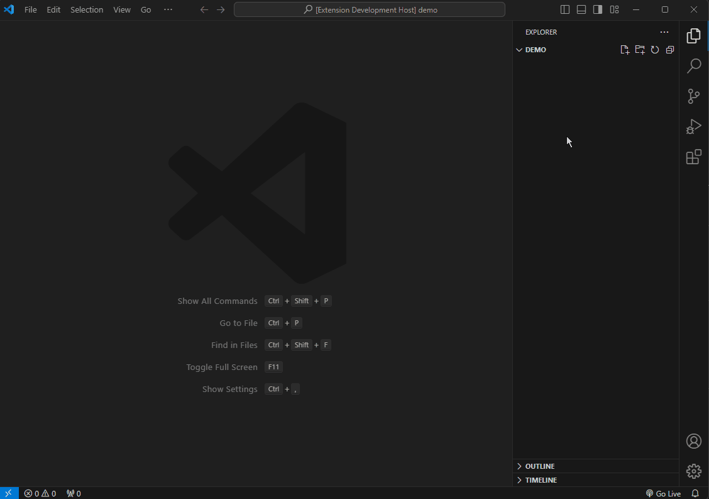

# Vemplate

使用代码片段（Snippet）快速创建 Vue 单文件组件。

## 功能

- 内置 Vue 2、Vue 3 模板，包含 CSS、SCSS、Sass、Less 与 TypeScript 组合。
- 自动汇集扩展内置预设、其它扩展贡献的片段、用户片段、工作区片段和可选的自定义目录。
- **仅显示明确支持 Vue 的片段**：语言专属 JSON 文件须以 `vue.json` 命名；`.code-snippets` 条目须在 `scope` 中显式包含 `vue`。未限定语言、通配符及仅适用于其它语言的片段不会显示。
- 片段列表第一行显示前缀和来源，第二行显示说明；可按前缀或说明搜索，并可在侧边栏预览片段内容。
- 记住上次使用的片段并置顶；其余片段按来源优先级排列，同一来源内的文件模板优先。
- 校验文件名，自动添加 `.vue` 后缀；重名时自动选择可用文件名（例如 `Foo.copy.vue`）。
- 任意步骤取消都不会创建空文件；提供 `Vemplate` 输出日志，便于诊断片段读取与解析问题。

## 使用方法

1. 在资源管理器中右键目标文件夹，选择 **Vemplate**。
2. 输入 Vue 文件名（建议使用 PascalCase，无需输入 `.vue` 后缀）。
3. 搜索并选择片段，即可创建 Vue 文件。

也可以在命令面板运行 **Vemplate**；扩展会先让你选择目标文件夹。输入文件名或选择片段时按 `Esc` 即可取消，不会留下空文件。

如果没有找到可用片段，Vemplate 会询问是否创建空白 Vue 文件。

## 片段来源与配置

| 来源 | 位置 |
| --- | --- |
| 内置预设 | 扩展自带的 `snippets/vue.json` |
| 其它扩展 | 通过 `contributes.snippets` 贡献、明确支持 Vue 的片段 |
| 用户片段 | VS Code 用户数据目录下的 `User/snippets` |
| 工作区片段 | 各工作区 `.vscode/*.code-snippets` |
| 自定义目录 | `vemplate.extraSnippetFolders` 设置中的目录 |

语言专属的 JSON 片段文件按文件名识别语言（例如 `vue.json`）；`.code-snippets` 中的片段只有在 `scope` 明确包含 `vue` 时才会列出。通用片段、`*` 通配范围和仅面向其他语言的片段会被排除。片段文件支持 JSONC 注释、尾随逗号和 UTF-8 BOM。

创建用户片段：

1. 在命令面板运行 **Snippets: Configure Snippets**。
2. 选择全局或 Vue 专属的 Snippet 文件并添加片段。
3. 可使用 [snippet-generator](https://snippet-generator.app/?description=&tabtrigger=&snippet=&mode=vscode) 生成 VS Code Snippet JSON。

片段列表会优先置顶上次使用的片段；其余按内置预设、工作区、用户、自定义目录、其它扩展的顺序排列，同一来源内文件模板优先。若不希望显示其它扩展提供的片段，可将 `vemplate.includeExtensionSnippets` 设为 `false`。

## 设置

| 设置项 | 默认值 | 说明 |
| --- | --- | --- |
| `vemplate.extraSnippetFolders` | `[]` | 额外扫描的片段目录，需填写绝对路径。 |
| `vemplate.includeExtensionSnippets` | `true` | 是否将其它扩展贡献的 Vue 片段加入列表。 |
| `vemplate.previewSnippetContent` | `true` | 选择片段时是否显示只读侧边预览。 |

## 故障排查

打开 **视图 → 输出**，在输出面板中选择 **Vemplate**，即可查看扫描到的来源、片段数量、过滤结果及解析错误。遇到片段文件读取或解析失败时会显示提示，可选择 **查看日志** 定位问题文件；不存在或不可读取的可选目录只记录在日志中。

## 开发

- `npm run compile`：检查类型、运行 ESLint 并打包扩展。
- `npm test`：编译并运行扩展测试。

## 版本记录

完整变更记录请参阅 [CHANGELOG.md](./CHANGELOG.md)。
